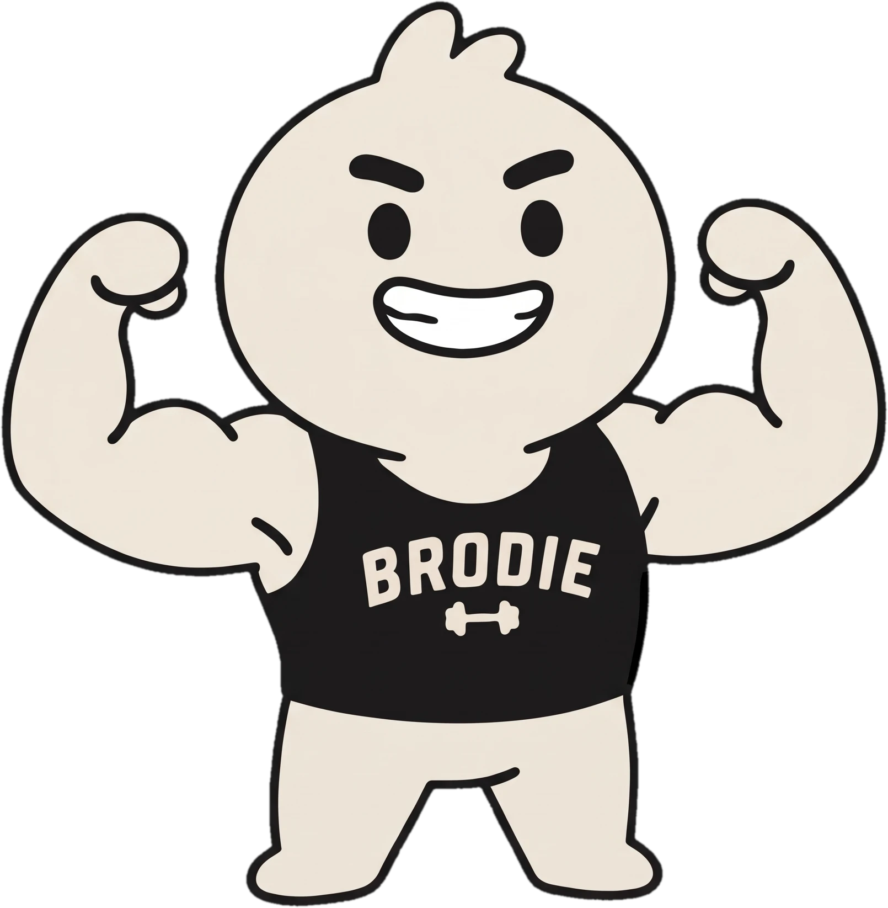
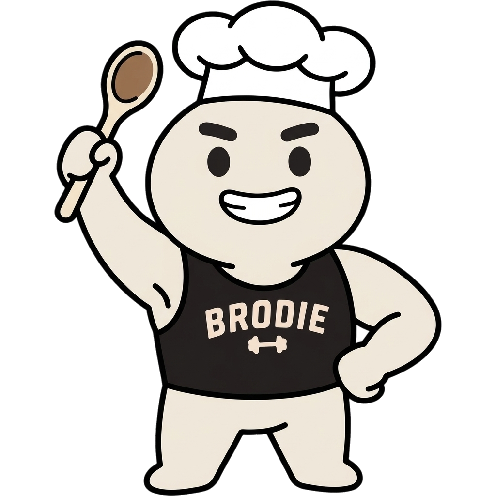
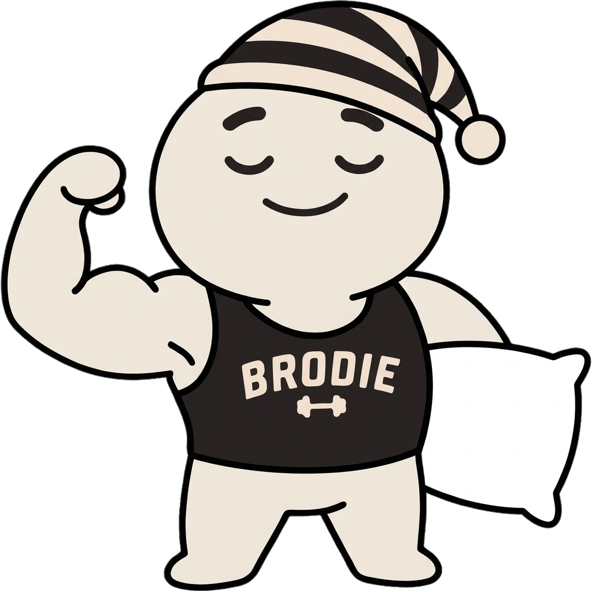
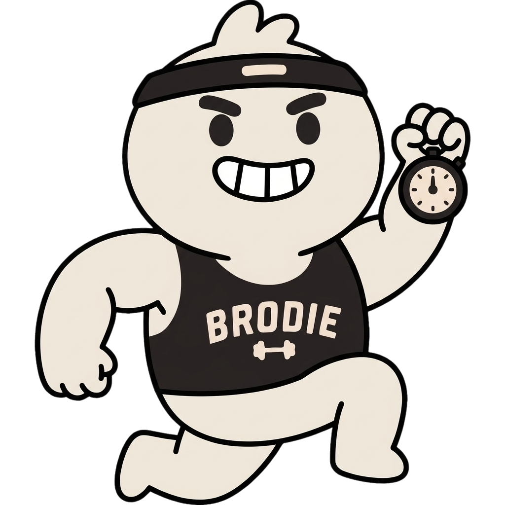

# Brodie character kit

Everything a builder or an agent needs to draw **Brodie** for a new skill (a chef's
hat for a macros coach, a nightcap for sleep, a sweatband for cardio) and still have
him look like Brodie.

- **Kit page:** https://brodie-character-kit.vercel.app/
- **Machine-readable spec:** [`brodie.json`](brodie.json) (colours, locked traits, prompt, QA thresholds, file URLs)
- **For coding agents:** [`AGENTS.md`](AGENTS.md) · Claude skill: [`skill/brodie-character/SKILL.md`](skill/brodie-character/SKILL.md)

<p>




</p>

## The one rule people break: he is cream, never pink

| Role | Hex | Use |
| --- | --- | --- |
| Body | `#EFE7DA` | Head, hair tuft, arms, legs, tank lettering. CIELAB L 91.9 · a* +0.5 · b* +7.3 |
| Ink | `#1A1919` | Outline, brows, eyes, tank top |
| White | `#FFFFFF` | Teeth and white props, only inside an outline |
| Tan | `#C2A882` | Speed marks, wooden props. Never on his body |

Image models drift him toward skin tone. `#F1E4D8` and `#F2E4D3` are real
rejected examples. Run every image through the checker before you ship it.

## Quick start

```sh
git clone https://github.com/seraphimlabs-dev/brodie-character-kit && cd brodie-character-kit
pip install -r requirements.txt

# 1. generate (Gemini image; uses both references + the canon prompt, auto-fixes colour)
GEMINI_API_KEY=... python3 tools/gen_brodie.py out.png \
  "Brodie as a macros coach: wearing a tall white chef's hat, holding a wooden spoon in his right fist, big grin, standing."

# 2. check (exit 1 on drift). Accepts files or URLs
python3 tools/check_cream.py out.png

# 3. fix a drifted image from any tool, then knock out the white background
python3 tools/fix_cream.py in.png fixed.png
python3 tools/cutout.py fixed.png sticker.png
```

Using another image tool (GPT image, Midjourney, Ideogram)? Attach **both** files in
`reference/`, then send the prompt from `brodie.json` → `prompt.template` (filled in) followed
by `prompt.canon` word for word. Check the result with `check_cream.py`.

## Locked

- Body colour `#EFE7DA`, including the hair tuft
- Black tank with arched cream **BRODIE** lettering and a small dumbbell, always readable
- Thick black bar brows; solid black oval eyes or one wink arc; no nose, ears, cheeks or blush
- One mouth: big grin with white teeth, or one small closed smile
- Big round head (~45% of height), big arms with round fists, short stubby legs
- Flat fills, thick even outline, no gradients, no 3D

## Yours to change

One hat or band · one prop per hand · expression · pose. Props never cover the
lettering ([reject example](examples/dont-lettering-covered.png)).

## Files

| Path | What |
| --- | --- |
| `reference/brodie-flex.png`, `reference/brodie-sit-wave.png` | Canon references. Always attach both |
| `pfp/brodie-pfp.png`, `pfp/brodie-pfp-square.png` | Profile picture, 512px, cream-corrected |
| `examples/` | Three costumed passes and two rejects |
| `tools/` | `check_cream.py`, `fix_cream.py`, `gen_brodie.py`, `cutout.py` (numpy + Pillow) |
| `brodie.json` | Single source of truth. `gen_brodie.py` reads its prompt from here |

Raw file base for agents: `https://raw.githubusercontent.com/seraphimlabs-dev/brodie-character-kit/main/`

## Usage

Brodie is a Seraphim Labs character. Shared so hackathon builders can make Brodie
skills. Please keep him on-model and don't use him for unrelated products.
